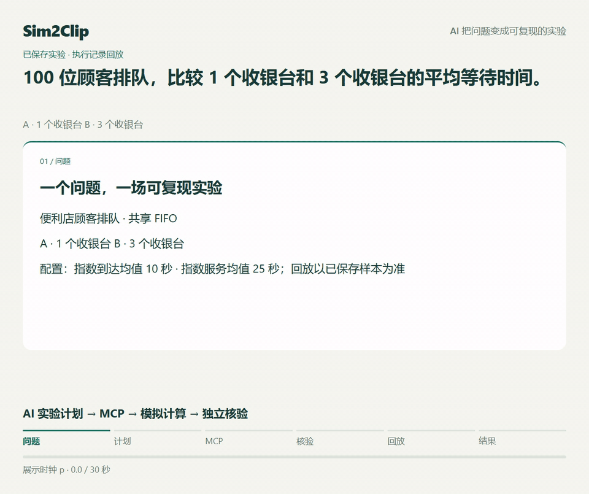
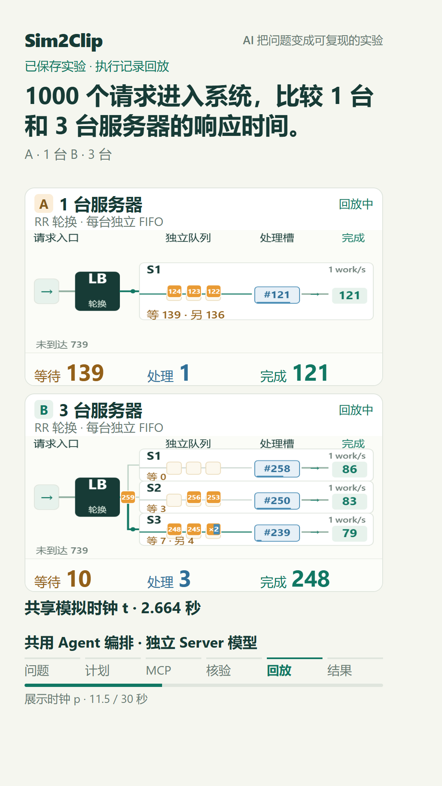
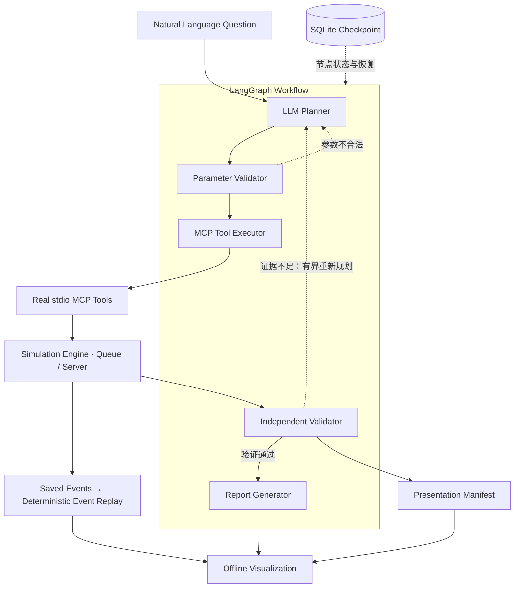

# Sim2Clip

**Sim2Clip turns natural language questions into reproducible simulation experiments.**

Sim2Clip 将自然语言问题转化为可复现、可验证的模拟实验。

**正式发布版本：v1.0.0。**

[GitHub Release v1.0.0](https://github.com/zynerox/sim2clip/releases/tag/v1.0.0) · [Offline Demo ZIP](https://github.com/zynerox/sim2clip/releases/download/v1.0.0/sim2clip-offline-demo-v1.0.0.zip) · [Queue Presentation MP4](https://github.com/zynerox/sim2clip/releases/download/v1.0.0/queue-presentation-v1.0.0.mp4) · [Server Presentation MP4](https://github.com/zynerox/sim2clip/releases/download/v1.0.0/server-presentation-v1.0.0.mp4)

下载并完整解压 Offline Demo ZIP，即可直接打开 Queue / Server HTML，无需安装项目或 API Key。
这些是已保存实验的回放，不会重新调用模型或执行模拟。

这是一个 AI Agent 系统：**LLM 负责实验规划，Simulation Engine 负责计算事件与指标，
Independent Validator 负责结果核验。**

自然语言问题 → 实验规划 → MCP 工具调用 → Simulation → Independent Validation → Offline Visualization

[Quick Start](#quick-start) · [Architecture](#architecture) · [真实 LLM 验证](#real-llm-validation) · [文档](docs/README.md)

主 Demo：**问题 → AI 实验计划 → MCP 调用 → 独立核验 → A/B 回放 → 结果揭晓**。
以下 30 秒 GIF 使用 R1 真实 ModelPlanner / Qwen3.5-Plus 执行的保存结果与核对过的收据；
它是演示回放，不是实时模型请求录屏，也不表示实验在 30 秒内执行完毕。



## Demo

### AI 能验证多开收银台是否值得吗？

Queue 场景比较 100 位顾客在 1 个与 3 个收银台下的等待时间。Agent 规划对照实验，
通过真实 MCP 执行模拟，独立核验后生成报告与同步 A/B 回放。

本次回放 **Seed 42** 的平均等待为 **745.18 秒 vs 20.59 秒**；
五个配对种子（42–46）的平均等待为 **789.52 秒 vs 33.27 秒**。两种口径分别标注。

这是有限模型实验，只验证假设条件下的等待时间变化。当前没有用工成本或收益模型，
**结果不代表现实商业决策，也不能证明增加收银台在经济上“值得”。**

[同步回放截图](docs/assets/phase7-4/queue-middle.png) · [结果揭晓](docs/assets/phase7-4/queue-reveal.png) · [Presentation Mode 说明](docs/presentation-mode-7.4.md)

### AI 能验证增加服务器是否改善响应时间？

Server Load Balancing 场景比较同一批 1000 个请求在 1 台与 3 台服务器下的响应时间，
使用 Round Robin 路由。它与 Queue 共用 LangGraph 编排，但拥有独立的计算模型、契约和验证器。

本次回放 **Seed 42** 的平均响应为 **7.1000 秒 vs 0.0876 秒**；
五个配对种子的平均响应为 **7.797612 秒 vs 0.107930 秒**。

这些数值来自已验证的有限负载模型，不是生产服务器压测或现实性能预测。

<a href="docs/assets/release/server-poster.png"></a>

[同步回放截图](docs/assets/phase7-4/server-middle.png) · [结果揭晓](docs/assets/phase7-4/server-reveal.png) · [服务器模型与验收](docs/server-load-balancing-m2.md)

Presentation Mode 用默认 30 秒呈现问题、计划、MCP 执行、独立核验、同步回放和结果揭晓。
**30 秒是展示时长，不是原始实验或模型请求的执行耗时。**
六阶段 Queue GIF、Server 封面、两场景竖屏 MP4 与离线 HTML ZIP 已正式公开并核验。
[v1.0.0 Release 页面](https://github.com/zynerox/sim2clip/releases/tag/v1.0.0) 提供正式下载附件。
下载时请同时获取页面中的 [SHA256SUMS.txt](https://github.com/zynerox/sim2clip/releases/download/v1.0.0/SHA256SUMS.txt)，核对 ZIP、两段 MP4 与配套发布说明。
来源、文件清单、SHA256、录制与核验步骤见 [Demo 素材与离线包](docs/release-demo.md)。
演示的源应用版本为 0.1.0，发布包装版本为 1.0.0；PROVENANCE 保留实验指标与文件校验信息。
这些媒体由发布录制脚本生成，普通 CLI 导出仍沿用现有能力。也可按 Quick Start 自行生成离线 HTML。

## Quick Start

需要 **Python 3.11+** 和 [uv](https://docs.astral.sh/uv/)。首次使用先克隆公开仓库，
再使用已提交的锁文件安装：

```powershell
git clone https://github.com/zynerox/sim2clip.git
cd sim2clip
uv sync --locked
```

### Demo Mode

无需 API Key，不请求外部模型。使用固定 **DemoPlanner** 规划官方 Queue 案例，
实际执行 **LangGraph workflow → stdio MCP → Simulation → Validation → Visualization**。

```powershell
uv run sim2clip run "100个顾客，比较1个收银台和3个收银台" --planner demo --thread-id queue-demo
```

完成后打开 `outputs/queue-demo/visualization.html`，无需启动 Web 服务。
普通导出默认 Analysis；在“观看模式”选择 **Presentation**，在“画面布局”选择桌面或 **9:16 竖屏舞台**，
再播放完整叙事。页面可以暂停、拖动时间轴、切换种子，并在 Analysis 查看详细参数与多种子汇总。

DemoPlanner 先执行一个配对种子的试验，再响应证据不足反馈补足种子。
这是固定演示规划，不能作为真实 LLM 自然语言理解或真实模型重规划的证据。
Demo Mode 只支持明确的官方 Queue 问题，不提供 Server DemoPlanner。

### Real Model Mode

需要支持标准 function / tool calling 的 Chat Completions 兼容模型。
首次配置时将 [.env.example](.env.example) 复制为本机 `.env`；已有配置请直接编辑。
填写以下三个变量，密钥只保留在本机：

```dotenv
MODEL_API_KEY=your-api-key
MODEL_BASE_URL=https://your-provider.example/v1
MODEL_NAME=your-tool-calling-model
```

`MODEL_BASE_URL` 填 API 根地址；SDK 会追加 `/chat/completions`。
现有环境变量优先于 `.env`。**真实模型模式会产生外部 API 请求，费用依供应商与账户规则而定。**

```powershell
uv run sim2clip run "100位顾客排队，比较1个收银台和3个收银台的平均等待时间" --planner model --thread-id queue-model
uv run sim2clip run "1000个请求进入系统，比较1台和3台服务器的响应时间" --planner model --thread-id server-model
```

模型根据问题和发现的工具 Schema 生成实验计划；事件与指标由 MCP 调用的引擎计算，
通过独立验证后输出报告、完整结果 JSON 和场景对应的离线 HTML。报告披露采用的默认假设。

每次新任务使用未占用的 `--thread-id`，或省略该参数让系统生成 ID；已有任务不会被覆盖。
对应页面位于 `outputs/<thread-id>/visualization.html`。请打开生成的 HTML，不要直接打开源码中的 HTML 模板。

运行结果保存在本地输出目录。请勿将包含 checkpoint、工具收据、私有运行记录或模型消息的本地结果提交到公开仓库。
安装替代方案、暂停、恢复与错误约定见 [CLI 文档](docs/cli.md)。

## Architecture

产品链路从自然语言问题开始，经过 LLM Planner、LangGraph 工作流、MCP 工具、
Simulation Engine 与 Independent Validator，最终生成 Offline Visualization。
Planner、参数校验、工具执行、结果校验和报告是同一 LangGraph 工作流中的节点。



- **SQLite checkpoint** 保存节点状态、决策和工具证据引用，支持跨进程恢复；大事件结果保存在外部 JSON。
- **Event Replay** 从保存的事件恢复任意模拟时刻的状态，A/B 使用共享模拟时钟。
- **Presentation Manifest** 保存结果引用与 SHA、展示配置和公开执行摘要；Agent 当时验证与导出复核分别标注，
  缺少收据时不会补造执行关联。它是展示层契约，不负责模拟计算。

[Agent 架构与恢复](docs/agent-workflow.md) · [MCP 协议与工具契约](docs/mcp-server.md) · [Presentation Manifest](docs/presentation-mode-7.4.md)

## Real LLM Validation

**Qwen3.5-Plus** 的真实模型验收累计 **12 次真实请求**，
覆盖 **Queue + Server** 及全部 **4 个 MCP tools**：

`run_simulation`、`compare_simulations`、`run_server_simulation`、`compare_server_simulations`。

证据包括原生 HTTP function calls 与 SDK `AIMessage.tool_calls` 的脱敏投影、
真实 stdio MCP 执行、参数、收据 SHA、LangGraph 节点及独立验证结果。

| 批次 | 真实请求 | 严格完整任务统计 |
| --- | ---: | --- |
| 原始 R1 两轮验收 | 10 | 8 个支持任务中 **6/8** 通过；另有 E/F2 两个拒绝案例 |
| 修复后 G/H 真实复验 | 2 | 单次 Queue / Server 完整任务 **2/2** 通过 |
| 累计请求量 | **12** | 分轮保留结论，不把原始 6/8 追改为 8/8 |

原始 G/H 的工具选择、参数和计算结果正确，但公开报告将单次实验误写成比较。
修复后重新真实执行 G/H 并取得 2/2，不用本地重导出改写原始验收统计。

验收边界：

- **E/F2 仅验证安全拒绝行为**：零工具执行，无虚构或非法模拟结果。原生拒绝正文未保存，
  未验证完整拒绝解释文本。
- **真实验收未触发重规划**。重规划、错误恢复与供应商失败分支的本地测试不能冒充远程模型证据。
- 12 次请求包含拒绝案例及 G/H 复验，不等于 12 个不同成功任务；小样本不代表任意自然语言的可靠性。

[完整验收报告](docs/real-llm-r1-verification.md)

## Technical Highlights

### Typed Tool Contracts

用严格的 Pydantic 输入输出模型解决 LLM 参数可靠性问题。参数先经过确定性校验，
MCP 返回值再按对应结果契约解析；结构合法只是第一层检查。[数据契约](docs/simulation-contract.md)

### Real stdio MCP Server

通过真实子进程、协议协商、工具发现和结构化响应明确 Agent 与执行工具的边界。
四个工具对应两种场景的单次与比较实验，错误不会伪装成成功指标。[MCP 文档](docs/mcp-server.md)

### Paired Experiment Design

每个种子的 A/B 使用同一批顾客或请求样本，只改变指定的比较变量，
减少样本差异对公平比较的干扰。逐种子差值与多种子汇总单独保留。[配对实验契约](docs/simulation-contract.md)

### Independent Validation

独立于引擎计算，根据保存的样本、事件和记录复核生命周期、FIFO、容量、指标及比较汇总，
拒绝不一致结果。它验证有限模型内的一致性，不能证明假设符合现实。[结果验证设计](docs/agent-workflow.md)

### Checkpoint Recovery

SQLite 节点状态与 SHA 校验工具收据支持长任务跨进程恢复，
避免重复执行已经保存的工具调用；恢复资料与公开展示投影分开。[恢复与证据](docs/agent-workflow.md)

### Deterministic Replay

保存事件驱动回放，正向播放、直接 seek 与反向 seek 对应相同状态。
相同输入、样本和固定运行版本支持模拟结果复现，不保证 LLM 每次生成相同计划。[回放语义](docs/visualization.md)

### Offline Visualization

完整结果、样式和脚本内嵌 HTML，生成后无需模型、CDN 或网络即可播放与检查。
Analysis 用于审查细节，Presentation 用于解释实验过程。[演示模式与验收](docs/presentation-mode-7.4.md)

## Limitations

当前支持：

- **Queue simulation**：便利店共享 FIFO 队列，有限顾客完成服务，比较收银台数量。
- **Server load balancing**：每节点独立 FIFO、固定处理能力，支持 Round Robin / Least Outstanding，
  容量、路由策略及异构处理速率实验。

当前是两个注册场景的**有限模型**，不是通用世界模拟器。
到达分布、服务时长、请求工作量和处理能力等是**假设参数**，报告会披露；
结果**不代表现实预测，也不代表统计显著性**。Server 不包含网络延迟、故障、超时或重试模型，
Queue 不包含成本与收益评估。

单个 Seed 的动画指标与多种子汇总不可混用。跨 Python / SimPy / Pydantic 版本不承诺结果字节一致。
当前验收环境以 Windows / Python 3.12 / Chromium 为主；Python 3.11+ 是声明要求，
不表示所有版本与系统都已实测。手机预览使用 Chromium CSS 视口，实体手机、Safari 与短视频平台覆盖层尚未验收。

## Documentation and License

[文档目录](docs/README.md) 提供架构、运行、模型、回放和验收入口。

| 入口 | 内容 |
| --- | --- |
| [Agent Workflow](docs/agent-workflow.md) | 规划、条件反馈、验证、工具证据与 checkpoint |
| [CLI](docs/cli.md) | Queue / Server 运行、四工具、模型配置、恢复与 Presentation 入口 |
| [Simulation Contract](docs/simulation-contract.md) | Queue 参数、样本、事件与指标契约 |
| [Server Model](docs/server-load-balancing-m1.md) | Server 模型、路由、假设与能力边界 |
| [Presentation Mode](docs/presentation-mode-7.4.md) | 六阶段、Manifest、截图与已保存的验收结果 |
| [Release Demo](docs/release-demo.md) | 真实媒体、离线包、来源与可复现录制步骤 |

已保存的全量工程验收记录为 **756 passed、0 失败 / 错误 / 跳过**，
详见 [Presentation 验收说明](docs/presentation-mode-7.4.md)。

项目使用 [MIT License](LICENSE)。
