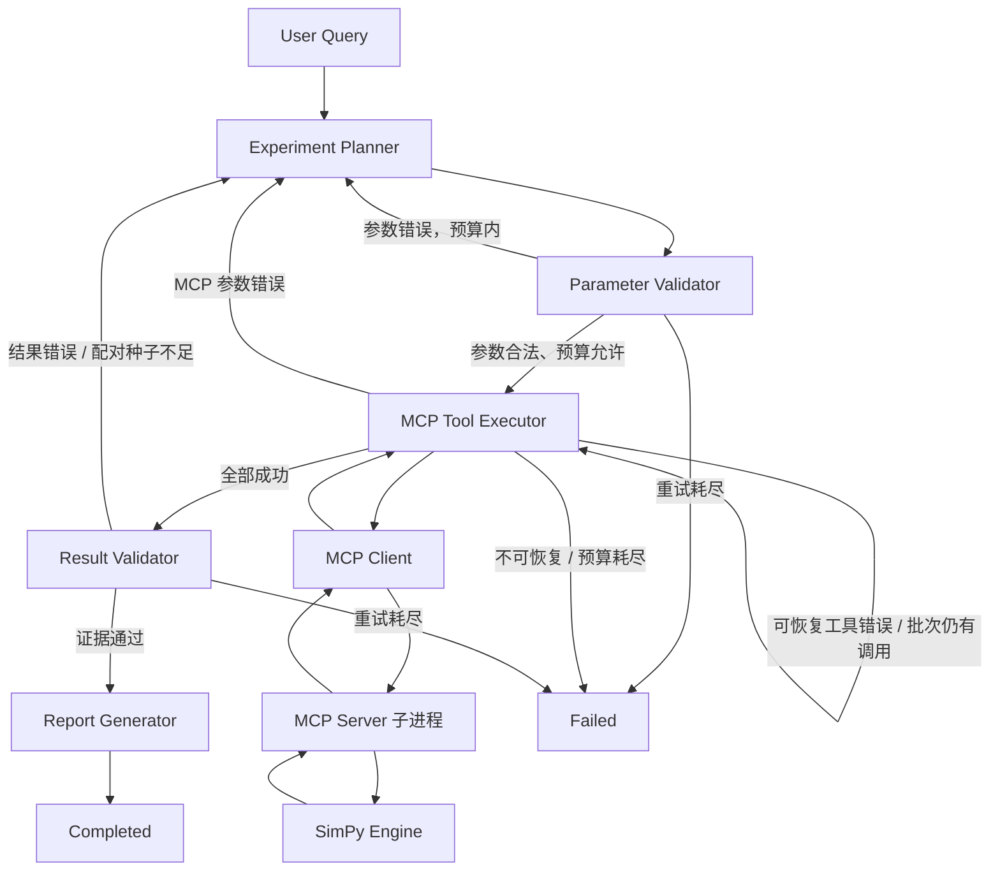

# LangGraph Agent Workflow

实现位于 `src/sim2clip/agent/`。Queue 与 Server 使用独立模型和验证器，通过 Scenario Registry
接入同一套规划、工具执行、验证和报告流程。详见 [多场景编排](multi-scenario-agent-m3.md)。
Agent 只使用 `simulation.schemas` 和 `scenarios.server_contracts` 的计算契约，
通过 MCP Client 与独立 Server 通信，不直接调用引擎。
报告数值来自 SimPy，规划模型不生成模拟结果。

## Graph 与数据流



五个节点各有实际职责：

| 节点 | 行为与输出 |
| --- | --- |
| Planner | 将自然语言与验证反馈交给支持工具调用的 LangChain 模型；使用 MCP `list_tools()` 返回的真实输入 Schema 绑定工具；记录 `AIMessage.tool_calls` 和模型返回的方案说明；原始状态属于本地运行资料 |
| Parameter Validator | 按注册工具解析 Queue 或服务器严格 Schema；拒绝未知工具、未知字段、不公平批次和超预算计划；锁定场景、目标、负载、实验组、指标和种子 |
| MCP Tool Executor | 每次节点执行只调用一个工具；解析 `isError` 和共享返回 Schema；保存原始结果与原子响应收据，再更新历史、游标和摘要；每次调用之间形成 checkpoint |
| Result Validator | 独立回放生命周期、FIFO、容量、队长与事件时间，重新核对记录指标、样本/运行哈希、配置、配对数据、比较汇总、差值、排名和并列结果；决定报告或返回 Planner |
| Report Generator | 再检查最终证据与文件校验和，生成确定性的 Markdown 报告、完整比较 JSON 和决策记录；不让模型编造指标或显著性结论 |

使用 `StateGraph`、`add_conditional_edges()` 与 `AsyncSqliteSaver`。
这是依据验证反馈决定是否继续实验的循环：执行第二轮不是固定 Chain 中预先安排的步骤。
参考官方 [Graph API](https://docs.langchain.com/oss/python/langgraph/graph-api)、
[Checkpointers](https://docs.langchain.com/oss/python/langgraph/checkpointers) 和
[Model Tool Calling](https://docs.langchain.com/oss/python/langchain/models#tool-calling)。

## State 契约

`SimulationAgentState` 是 TypedDict。所有状态值都是可 JSON 序列化的数据；模型、MCP 会话、
数据库连接、SimPy Environment 都留在 runtime 中。

| 字段 | 含义 |
| --- | --- |
| state_version / scenario_id / schema_version | 新 State 版本 2、已锁定场景（合法计划之前为 null）、场景契约版本 1；旧 Checkpoint 在节点入口兼容投影 |
| user_query | 原始用户问题，始终保留 |
| experiment_goal | 模型规划的结构化目标；离线 Demo 保留原始目标 |
| experiment_plan | 当前规划说明和拟调用工具的参数；保留 provider call ID |
| validated_request | 已用共享 Schema 校验并补齐默认值的工具请求批次 |
| tool_calls | 每次实际尝试的内部 call ID、轮次、工具、参数、次数、成功/失败、错误、结果引用；追加 reducer |
| simulation_results | 当前执行批次按 result_id 去重的配置、指标、文件路径与 SHA-256；完整事件在原始 JSON 中 |
| comparison_result | 当前执行批次中最近比较结果的引用、配对种子、汇总和赢家；完整请求、逐种子差值与运行位于引用文件 |
| validation_result | 数据完整性、证据是否足够、检查范围和失败原因 |
| decision_history | 节点、轮次、路由行动和简要依据；追加 reducer，不保存模型的私有推理 |
| retry_counts | 参数重新规划、工具重试、结果重新规划各自的计数 |
| status | planning / replanning / executing / validating / completed / failed |
| messages | 序列化的 HumanMessage / AIMessage / ToolMessage；模型只接收紧凑结果，事件不进入模型上下文 |
| run_id / planner_mode | 任务标识与 llm / offline_demo 等规划模式 |
| planning_round / call_cursor | 当前规划轮次、批次中下一个待执行调用 |
| customer_runs / policy | 保留旧字段名；累计顾客或请求 run 的工作预算与持久化执行策略 |
| design / feedback | 已锁定实验设计与供下一轮规划消费的验证反馈 |
| errors / next_action / artifacts / report | 错误、下一节点、产物路径与报告正文 |

每次重新规划生成 `r<round>-c<index>` 形式的调用 ID。工具错误重试复用 ID，attempt 增加；
多次实验使用同一运行结果时按 result_id 去重。State 中不另建一套模拟输入输出 Schema。

## 证据策略与错误恢复

默认对比需要至少 **5 个配对种子**；共享样本和指标复核都通过才报告。
服务器 batch 到达 + constant 工作量没有随机性，最低一次即可；其他服务器比较沿用最低种子策略。
这是可配置的描述性证据策略，不是统计显著性检验。单个配置允许报告单次观察。
重新规划须保持人群、到达/服务设置、收银台组和基线顺序，并保留已选种子，避免更换问题或挑选结果。
工具结果本身作为数据反馈给模型，不能作为新指令覆盖规划约束。

默认预算：参数重新规划 2 次、工具重试 2 次、结果重新规划 2 次，
单批最多 4 个工具、任务最多 12 次工具尝试和 100000 个 customer-runs。
失败尝试也保守计入 customer-run 预算；响应收据恢复按该逻辑调用计一次预算。
预算和计数持久化，重启不重置。耗尽时 `status=failed`，不给未经验证的成功报告。

| 失败 | 行为 |
| --- | --- |
| 本地共享 Schema 校验失败 | 返回 Planner，非法请求不会发送到 MCP |
| MCP INVALID_PARAMETERS | 完成工具批次的错误消息，反馈给 Planner |
| 工具明确标记 retryable=true | 保持同参数重试 Executor，受工具次数和工作预算限制 |
| MCP 传输错误 | 重建会话后重试幂等工具；重连失败则结束 |
| ENGINE_ERROR / INVALID_RESULT / UNKNOWN_TOOL | 停止，保留错误和历史；当前 Server 将确定性引擎错误标记为不可重试 |
| 形状正确但事件/指标不一致 | Result Validator 拒绝，有限次返回 Planner 重新获取证据 |
| 比较种子不足 | 反馈所需种子数，由 Planner 决定下一轮工具调用 |

Graph 的重试是业务决策；`recursion_limit=100` 另外限制执行步数。
模型调用失败会明确结束，不自动切换成假模型或生成伪实验。

## SQLite 恢复语义

`open_workflow()` 管理异步 SQLite saver 和 MCP 会话的生命周期。
`thread_id` 是任务 ID，`ainvoke(..., durability="sync")` 在继续下一步前落盘。
同一个 SQLite 文件可以容纳不同任务；当前运行 API 要求每个任务 ID 仅创建一次。
这是本地串行 workflow，调用方应避免同时写同一个任务和产物目录。

恢复使用相同 checkpoint 路径、artifact_root、thread_id 与兼容的代码/规划器：

```python
async with open_workflow(planner, checkpoint_path=db, artifact_root=output) as workflow:
    state = await workflow.resume(thread_id="rush-001")
```

恢复会先读 snapshot，未完成则 `ainvoke(None, config)`，完成任务复核持久化证据后返回已有状态，不重复执行工具。
兼容性读取从持久化工具名与旧 Queue 设计推断缺失的 scenario_id，补充版本与设计元数据；
不依赖 initial_state 默认值，不重写历史 Checkpoint，不重置待执行节点或计数。
历史源码在隔离进程生成的六类旧 Checkpoint 已作为跨版本恢复测试基线。
新批次首次成功执行时重建结果摘要，避免不同版本的结果 ID 混入当前核验；
历史工具调用、原始响应、收据和旧 Checkpoint 继续保留。
检查节点历史可用 `graph.aget_state_history(config)`，待执行节点见 `graph.aget_state(config).next`。
暂停时 status 保留节点阶段，`snapshot.next` 决定是否还有工作。
`interrupt_before` / `interrupt_after` 可在指定节点边界中断执行；当前没有审批 UI。

原始响应采用原子替换和文件 SHA-256 校验；完整事件保存在结果文件中。
SQLite 保存结果摘要、文件引用和工作流状态，恢复需要同时保留结果目录。
响应已写收据而节点 checkpoint 未提交时，重放会复用该收据。
如果进程在服务端完成、客户端收据尚未写入时终止，恢复可能重复计算一次。
这里提供**至少一次执行 + 确定性幂等结果**，不承诺跨 MCP 与 SQLite 的分布式恰好一次。

## 完整运行示例

无需 API Key 的演示明确使用 `DemoPlanner`：只支持官方 100 顾客、1 vs 3 收银台的中文问题，
不声称理解任意自然语言。首次规划执行 seed 42 的试验；验证器要求至少 5 个配对种子，
第二轮通过 MCP 调用种子 42–46 的比较。该演示依然使用真实 LangGraph、SQLite、MCP 子进程与 SimPy。

```powershell
uv sync --locked
uv run python examples/agent_workflow.py "100个顾客，比较1个收银台和3个收银台" --thread-id rush-001
```

当前 Windows 项目环境也可以直接使用：

```powershell
.\.venv\Scripts\python.exe examples/agent_workflow.py --thread-id rush-001
```

输出目录为 `outputs/agent-demo/runs/rush-001/`：

```text
report.md                    经验证的报告
comparison.json              原始共享 ComparisonResult，含所有事件
decisions.json               本地决策记录，包含模型返回的规划说明
state.json                   完整状态快照，包含原始问题与模型消息
graph.mmd                    从已编译 Graph 导出的 Mermaid
r1-c0-<hash>.json             第一次工具响应
r1-c0-<hash>.receipt.json     对应请求与校验和
r2-c0-<hash>.json             第二次工具响应
r2-c0-<hash>.receipt.json
```

这些是 Python 示例的本地输出，未经过 CLI 的公开字段筛选。`state.json`、
`decisions.json` 和 SQLite 可能包含输入内容及模型消息，分享前需单独检查，
不要直接上传整个输出目录。CLI 的导出范围见 [CLI 文档](cli.md)。

SQLite 位于 `outputs/agent-demo/checkpoints.sqlite`。
官方默认结果的 5 种子平均等待：1 收银台 **789.52 秒**，3 收银台 **33.27 秒**。
汇总最大队长均值分别为 **63.80**、**11.20**。完整比较有 10 个运行和 3000 条回放事件；
最终摘要对应第二轮比较，第一次调用历史仍保留。

跨进程暂停与恢复：

```powershell
uv run python examples/agent_workflow.py --thread-id rush-resume --pause-after-tool
uv run python examples/agent_workflow.py --thread-id rush-resume --resume
```

首次输出 1 次工具尝试、下一节点 result_validator；退出进程后恢复输出 completed、
2 次工具尝试、2 轮规划、1 次证据补充。若复跑完整任务，应换任务 ID；已有任务使用 `--resume`。
这些参数用于 Python 工作流示例，命令行用法见 [CLI 文档](cli.md)。

## 接入真实规划模型

`ModelPlanner` 接受任意支持 `bind_tools()` 的 LangChain `BaseChatModel`，
不要求计算或仿真能力。它使用 MCP 发现的 Schema 进行真实模型 Tool Calling，
并在后续轮次收到 ToolMessage 与验证反馈。计划必须经过本地验证后才执行。

模型适配器属于基础依赖，统一加载 `.env` 和环境变量：

```powershell
uv sync --locked
$env:MODEL_NAME = "你的工具调用模型名称"
$env:MODEL_API_KEY = "你的密钥"
$env:MODEL_BASE_URL = "你的兼容API根地址"
uv run sim2clip run "100个顾客，比较1个收银台和3个收银台" --planner model --thread-id rush-model
```

`.env.example` 提供字段示例；CLI 和原有示例现在都读取当前目录 `.env`，环境变量优先。
ModelPlanner 在原有 MCP 请求 Schema 外加入规划信封，保存模型生成的目标、理由与假设，
执行前还原为共享 MCP 参数；完整契约见 [CLI 文档](cli.md)。
没有凭据时不能运行在线模型。测试用 LangChain 模型夹具验证 Schema 绑定、真实 AIMessage 工具调用
和 ToolMessage 回传，未调用付费远程模型；离线 Demo 结果不作为在线 LLM 成功证据。

## 验证

```powershell
uv run pytest tests/agent -q
uv run pytest -q
uv run ruff check .
uv run ruff format --check .
uv run mypy
```

测试覆盖正常流程、负数/未知参数重新规划、独立结果复核、证据不足后的第二轮工具调用、
可恢复与不可恢复工具错误、各类有限预算、冻结实验设计与保留种子、同批多个工具、
SQLite 节点前后恢复、完整响应收据恢复、真实进程重启、丢失原始证据时拒绝报告、
状态 JSON 序列化及禁止 Agent 直接导入引擎实现。

模拟引擎的全局 RNG 不变检查仍覆盖引擎/MCP 测试。LangGraph 使用全局 RNG 分配 checkpoint ID，
Agent 测试不把这个编排库行为误判为引擎非确定性；模拟样本与结果依然使用独立随机流。
