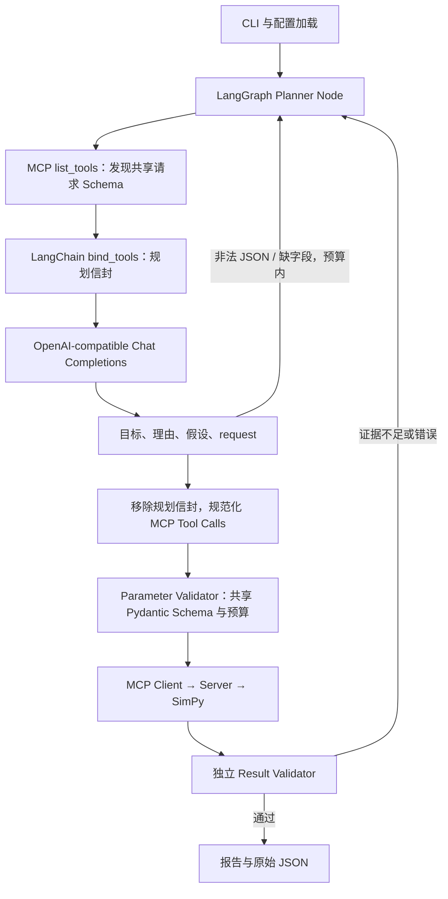

# Sim2Clip v1.0.0 CLI：运行、恢复与离线展示

`sim2clip` 是安装包提供的正式命令。`python -m sim2clip` 调用同一入口。
两种 Simulation Engine 保持独立；CLI 不计算指标，不调用引擎接口。
当前支持 Queue 与 Server Load Balancing，共用 run/resume 命令和 LangGraph 工作流，
使用各自的模拟契约、独立验证与离线可视化。当前正式发布版本为
[v1.0.0](https://github.com/zynerox/sim2clip/releases/tag/v1.0.0)。
场景接入与恢复兼容见 [多场景文档](multi-scenario-agent-m3.md)。

## 安装与运行

需要 Python 3.11+：

```powershell
uv sync --locked
uv run sim2clip --help
```

也可以 `python -m pip install -e .`，然后在该虚拟环境中使用 `sim2clip`。
当前 Windows 项目环境可直接调用 `.\.venv\Scripts\sim2clip.exe`。
模型适配器现在是产品的基础依赖，无需安装额外的 llm extra。

### 真实模型模式

复制 `.env.example` 为项目当前目录的 `.env`，填写以下三个值：

```dotenv
MODEL_API_KEY=你的密钥
MODEL_BASE_URL=你的Chat-Completions兼容API根地址
MODEL_NAME=你的工具调用模型名称
```

例如本地服务的 API 根地址可以是 `http://localhost:8000/v1`。
SDK 在根地址后请求 `chat/completions`；不要填完整的 `/chat/completions` 地址。
模型必须支持标准 function/tool calling，返回合法的工具参数 JSON。
第三方扩展字段（例如 reasoning_content）不作为规划契约或实验证据。

```powershell
uv run sim2clip run "便利店午高峰有100位顾客，比较1个和3个收银台的平均等待时间" --planner model --thread-id lunch-model
```

`model` 为默认模式，因此配置好 `.env` 后可以直接：

```powershell
sim2clip run "100个顾客排队，比较不同收银台数量"
```

任务 ID 默认生成 `run-<uuid>`；使用 `--thread-id` 固定 ID 可方便恢复。
默认输出根目录 `outputs/` 包含 SQLite、`runs/<任务ID>/` 原始证据与 `<任务ID>/` 展示产物。

服务器场景同样由真实模型工具调用选择：

```powershell
sim2clip run "1000个请求进入系统，比较Round Robin和Least Outstanding的平均响应时间" --planner model --thread-id servers
sim2clip resume servers
```

原始工具证据与任务记录保存在 `runs/<任务ID>/`，展示产物保存在 `<任务ID>/`；默认输出根目录可通过 CLI 参数调整。
JSON 摘要包含 scenario_id、schema_version 和 visualization.supported。
Queue 与 Server 都可导出场景对应的自包含 `visualization.html`；服务器页面实际展示
请求分流、每节点独立队列、处理和完成状态，不使用便利店渲染器。

打开 `outputs/<任务ID>/visualization.html`，普通导出默认为 Analysis；在“观看模式”选择
Presentation，再选桌面或 9:16 布局，可播放问题、计划、MCP、核验、A/B 回放和结果揭晓六阶段。
这是保存结果与执行记录回放，不重新调用模型；默认 30 秒是展示时长。
参数、Seed、多种子汇总与能力边界见 [Presentation Mode](presentation-mode-7.4.md)。

### 离线 Demo 模式

```powershell
uv run sim2clip run "100个顾客，比较1个收银台和3个收银台" --planner demo --thread-id lunch-demo
```

`DemoPlanner` 只支持官方固定案例，不需要模型配置或网络模型。
输入必须明确描述顾客和收银台；不能将含相同数字的服务器问题转换为便利店。
没有 Server DemoPlanner；无需 API Key 观看的 Server 保存结果演示已存在，见
[Demo 素材与离线包](release-demo.md)。固定 MCP 示例、DemoPlanner 与真实 ModelPlanner 分别标注。
它先规划一个配对种子，收到证据不足反馈后补足种子 42–46。
后续 LangGraph、MCP、SimPy、结果复核和报告生成与模型模式共用同一条链路。
默认实验的 5 种子平均等待为 789.52 秒与 33.27 秒。

## 配置与参数

| 项目 | 行为 |
| --- | --- |
| MODEL_API_KEY | 模型凭据；通过 SecretStr 管理，不保存到 State、SQLite 或产物 |
| MODEL_BASE_URL | 必须为 HTTP(S) API 根地址；拒绝 URL 中的用户名、密码、查询串和 fragment |
| MODEL_NAME | 用户选择的工具调用模型，不硬编码某个厂商模型 |
| .env | 默认仅加载当前目录的文件，不自动寻找上级目录，也不修改 os.environ |
| --env-file PATH | 显式选择配置文件；文件不存在时返回配置错误 |
| --planner-timeout SECONDS | 单次模型规划总超时，默认 60 秒，范围 (0, 3600] |
| --output PATH | checkpoint 与原始证据的根目录，恢复时必须使用相同目录 |
| --thread-id ID | 新任务 ID，1–80 个字母、数字、下划线或连字符 |
| --pause-after-tool | 保存一个工具调用后暂停，用于检查和恢复演示 |
| --json | stdout 只输出一个 JSON 摘要；MCP 日志在 stderr |

配置优先级：命令行行为选项 > 现有环境变量 > `.env` 中同名变量。
MODEL_* 三项通过环境或文件设置；CLI 不接收密钥参数，避免出现在 shell 历史中。
dotenv 不做变量展开。`.env` 已被 `.gitignore` 忽略，`.env.example` 可以提交。

```powershell
$env:MODEL_NAME = "另一个模型名称"
uv run sim2clip run "100个顾客，比较1与3个收银台" --env-file .env --planner-timeout 30
```

## ModelPlanner 架构与数据契约



通过真实 stdio MCP 发现并调用四个工具：

| 场景 | 单次实验 | 配对比较 |
| --- | --- | --- |
| Queue | `run_simulation` | `compare_simulations` |
| Server Load Balancing | `run_server_simulation` | `compare_server_simulations` |

模型规划信封携带目标、理由、假设和 `request`，其中请求嵌入 MCP 动态发现的对应工具 Schema。
下面仅为 Queue 比较的结构示例；Server 使用独立配置与比较契约：

```json
{
  "experiment_goal": "比较收银台数量对100位顾客平均等待的影响",
  "rationale": "只改变收银台数量，用配对种子保持需求相同",
  "assumptions": ["到达间隔均值10秒", "服务时长均值25秒"],
  "request": {
    "experiments": [
      {"cashiers": 1, "customers": 100},
      {"cashiers": 3, "customers": 100}
    ],
    "seeds": [42, 43, 44, 45, 46]
  }
}
```

`PlanningEnvelope` 是规划元数据，未创建第二套模拟配置或结果 Schema。
嵌入时保留原 Schema 的 `$defs` 引用语义；执行前只把 `request` 交给
Queue 的 `SimulationConfig` / `ComparisonRequest`，或 Server 的
`ServerSimulationConfig` / `ServerComparisonRequest`。MCP Server 收到实际请求参数，不接收规划信封。

模型生成的目标写入 `experiment_goal`，理由与假设写入 `experiment_plan.metadata`。
所有实际 MCP 参数、调用结果和 ToolMessage 仍保存到原有 State。
模型下一轮接收紧凑结果、固定设计、已确定目标、剩余策略和验证反馈。
模型自由文本不会成为实验数据；规划信封拒绝额外的 metrics / events 字段。
报告数值只来自通过独立验证的 MCP 结果，并标注模型实验假设。

这不是把 LLM 输出直接打印成报告：计划先通过 Schema 和预算校验，再执行真实工具；
非法参数、非法模型输出、证据不足均会通过条件边返回规划阶段。

| 对比 | DemoPlanner | ModelPlanner |
| --- | --- | --- |
| 目标理解 | 官方 Queue 固定案例的有限规则 | 模型规划受支持的 Queue / Server 有限实验 |
| 结构化计划 | 固定场景，响应种子补充反馈 | 原生 function calling，包含目标与 request |
| 配置 | 不需要模型凭据 | MODEL_API_KEY / MODEL_BASE_URL / MODEL_NAME |
| 网络 | 不请求模型服务 | 请求配置的 Chat Completions endpoint |
| 计算 | 真实 MCP / SimPy | 真实 MCP / SimPy |
| 复现边界 | 固定规划可复现 | 模型规划不保证相同；执行参数与结果固定后可复现 |
| Workflow | 共用 State、验证、checkpoint、报告 | 共用 State、验证、checkpoint、报告 |

## 错误与恢复

非法 JSON、缺少规划字段或未知规划工具会返回 `INVALID_PLAN_JSON`
或 `INVALID_PLAN`，反馈给 Planner，复用既有参数重新规划预算（默认最多补救 2 次）。
没有结构化工具调用时，按当前能力与显式数量边界返回终止错误（如 `UNSUPPORTED_REQUEST`），
不会执行模拟或自动反复请求模型。
负数、未知模拟字段等仍由共享参数 Validator 处理，非法请求不会发送到 MCP。
模型直接提供结果不会生成成功报告，也不会自动降级为 DemoPlanner。

`asyncio.timeout` 限制单次规划总时长；超时返回 `PLANNER_TIMEOUT`。
SDK 的自动请求重试关闭，避免额外重试在 Graph 预算之外发生。
鉴权或服务端错误返回 `PLANNER_REQUEST_ERROR`；错误正文和凭据不会被写入公开 State。
工具错误采用有限重试；超出预算后明确终止任务。

```powershell
uv run sim2clip run "100个顾客，比较1个收银台和3个收银台" --planner demo --thread-id recover-demo --pause-after-tool
uv run sim2clip resume recover-demo
```

恢复自动读取原规划器模式，不能通过 `--planner` 切换为另一模式。
恢复已校验的工具请求或已完成的工具结果时，只有需要新的规划才加载模型凭据。
因此模型任务暂停于工具之后，若结果已足够，删除 `.env` 后也能继续验证并生成报告。
规划开始前的初始 checkpoint 已保存 planner_mode，可以在新进程中识别并恢复。
已完成任务恢复时不重新请求模型或执行已保存的工具；新任务不能覆盖已有 ID。

默认 `--output` 为 `outputs`。自定义目录时，两个命令都要传相同目录：

```powershell
uv run sim2clip resume recover-demo --output outputs/my-experiment --json
```

SQLite 和原始响应目录必须同时保留。原子响应收据避免响应已落盘后的重复计算，
仍沿用至少一次执行与幂等结果语义。CLI 的 `state.json` 是检查快照，恢复以 SQLite 为准。
重试耗尽后的 failed 任务已终止，resume 返回失败状态；修改配置后应创建新任务。
Ctrl+C 返回任务 ID 和退出码 130；若已存在 checkpoint，可用同一 ID 恢复。

| 退出码 | 含义 |
| --- | --- |
| 0 | completed，或明确请求的 paused |
| 1 | Agent 或运行时失败，包括模型超时、工具错误、证据预算耗尽 |
| 2 | 配置、参数、未知 checkpoint 或已有任务冲突 |
| 130 | 用户中断 |

## 产物

启用可视化时的主要产物如下：

```text
outputs/
  checkpoints.sqlite         工作流恢复状态
  runs/<thread-id>/           原始工具证据与任务记录
    comparison.json          对比实验的完整 Queue / Server 比较结果
    r*-c*-<hash>.json         每个成功工具响应的原始数据
    r*-c*-<hash>.receipt.json 对应请求和文件校验和
  <thread-id>/                展示产物
    report.md                面向用户的实验报告
    result.json              可视化使用的完整结果
    state.json               公开状态投影
    decisions.json           公开决策记录
    graph.mmd
    visualization.html
    agent-timeline.json
    demo.gif                 Queue 可视化导出
    demo.frames.json          Queue GIF 帧清单
```

单次模拟的完整 Queue / Server 结果在工具响应文件中，报告摘要列出相应路径。
两种场景均支持离线 HTML、Analysis / Presentation 与桌面 / 9:16 布局。
Queue 现有 CLI GIF 与发布用六阶段 GIF 属于不同生成入口；Server GIF 不在当前 CLI 支持范围。
完整产物目录和回放规则见 [Visualization 文档](visualization.md)、
[Server 回放](server-visualization-m4.md) 和 [Presentation Mode](presentation-mode-7.4.md)。
展示文件默认位于任务输出目录；原始证据和恢复资料由本地运行配置管理。
可以通过 `--skip-visualization` 只运行实验。

## 测试与实测范围

```powershell
uv run pytest tests/cli -q
uv run pytest -q
uv run ruff check .
uv run ruff format --check .
uv run mypy
```

CLI 测试通过本地 HTTP 协议夹具驱动真实 ChatOpenAI SDK，并执行真实 stdio MCP 子进程和 SimPy。
CLI 初始验收记录：全量 **154 项测试通过**，其中 CLI/配置新增 **27 项**；严格 mypy、Ruff、
格式检查和 uv 锁文件检查均通过。
HTTP 夹具只模拟模型服务的响应格式，不是一个语言模型，也不产生模拟指标。
覆盖中文/英文输入、默认 `.env` 和显式文件、环境优先级、非法 JSON 修复与耗尽、非法参数重规划、
拒绝模型结果、规划超时、服务错误脱敏、工具失败、多轮 ToolMessage、节点前后 checkpoint、
跨进程恢复、无凭据恢复、任务冲突和中断摘要。

上述 CLI 初始验收使用本地 HTTP 夹具，未调用外部付费模型。后续真实 Qwen3.5-Plus
验收覆盖 Queue / Server 四工具，累计 12 次请求；原始严格完整任务 6/8，修复后 G/H 2/2，
详见 [真实 LLM 验收](real-llm-r1-verification.md)。该验收不等于每项远程任务都通过 CLI 子进程执行。
测试数字为已保存的验收记录；配置 .env 后，模型模式会请求对应模型服务。
实现依据为官方 [ChatOpenAI 集成](https://docs.langchain.com/oss/python/integrations/chat/openai)
和 [python-dotenv](https://bbc2.github.io/python-dotenv/) 文档。
