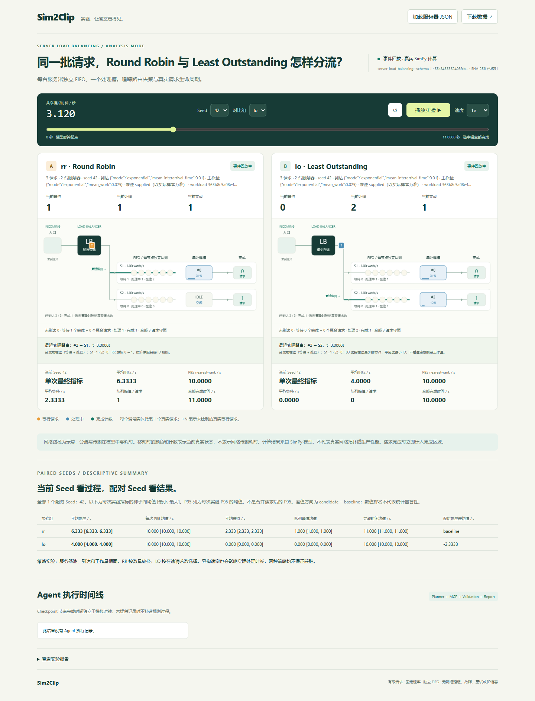

# Server：事件回放与交互式可视化

Server 回放根据已保存的请求事件和记录呈现分流、独立队列及完成状态。
本文包含桌面回放的实现及验收记录；竖屏布局见 [9:16 舞台](visualization-vertical-7.3.md)，
六阶段叙事见 [Presentation Mode](presentation-mode-7.4.md)。
普通导出支持离线 HTML，Server GIF 返回 unsupported；发布视频见 [Demo 下载](release-demo.md)。
## 观看入口与样例

公开离线 HTML 和演示视频见 [Demo 与离线包](release-demo.md)，无需模型凭据或 Web 服务。
下面列出保存的回放验收样例，由 M2 引擎计算并经独立验证。
其中手算与压力样例用于检查展示语义，不能作为真实 LLM 案例。

| 样例 | 数据与用途 |
| --- | --- |
| 容量比较 | 1000 请求，1 台 / 3 台，RR 固定，Seed 42–46 |
| 策略比较 | 1000 请求，两台速率 1 的服务器，RR / LO，Seed 42–46 |
| 异构节点 | 1000 请求，速率 1 / 2，相同池的 RR / LO，Seed 42–46 |
| FIFO 手算 | M1 手算 A，单服务器，supplied 样本 |
| RR / LO 手算 | M1 手算 B/C，两个独立组、同一 supplied 样本、Seed 42 |
| 批量到达压力样例 | batch/constant 的计数、积压和聚合压力样本 |
| 指数负载压力样例 | 10000 请求，指数到达及指数工作量 |
| Agent Timeline | M3 已验证服务器结果与真实 SQLite Checkpoint 执行时间线 |

Agent 页面只消费历史 M3 完整结果、State 与 Checkpoint，没有重新执行模型或 MCP。
本页的 CLI 检查使用本机 HTTP 夹具、真实 SDK Tool Calling、stdio MCP、
LangGraph 和跨进程 SQLite 恢复，不属于远程 LLM 验收。

## 分层与事件语义

`parse_result` 按契约识别 Queue / server；未知场景明确拒绝。服务器结果先经 M2 独立
`validate_server_simulation` / `validate_server_comparison` 复核样本、种子、路由、生命周期、
同刻顺序、指标、哈希、配对与汇总，再进入独立回放与 Canvas。

```text
ServerSimulationResult / ServerComparisonResult
  → 独立证据验证
  → ServerEventReplay（精确业务状态）
  → ServerSceneTimeline / ServerScenePose（固定布局 + 绝对时刻采样）
  → 服务器 Canvas 2D
  → 全部数据、Schema、脚本、样式内嵌的离线 HTML
```

没有调用 Queue Engine、Queue EventReplay 或 Queue Scene 来画服务器。Queue 继续走既有
三事件回放、便利店 Scene 和 Pillow GIF。GIF 模块只调整类型注解以区分 QueueResult，
原绘制与帧逻辑未修改。

服务器回放读取 `sequence` 原始顺序，Seek 结算所有 `timestamp <= t` 的事件；M2 Validator
和浏览器独立校验要求 M1 顺序：同刻全部完成（服务器 ID 升序）→ 旧等待请求启动
（服务器 ID 升序）→ 新到达请求按 ID 逐个 arrived / routed / 必要 started。
不按图形类型重新排序，不以容差合并不同时间戳。

每个请求经过 not_arrived → arrived → waiting → processing → completed。
arrived/routed/立即 started 可以同刻发生，画面展示整个同刻结算后的真实状态；
因此 t=0 的首个请求可出现在入口，同时真实处理槽已经占用。颜色、计数与处理进度表示
真实业务状态，路径不引入网络延迟。等待结束后从队列头向处理槽移动；完成时立即移除
实体并增加对应节点的完成计数，不延长完成时间。

每条服务器泳道独立显示真实 server_id、work/s、FIFO 队列、单处理槽、处理进度、
等待/处理/在途数及完成数。RR 最近路由记录显示实际游标；LO 显示分流前各节点的
等待+处理中数量及最小 ID 平局规则。LO 不按速率或剩余工作量加权，不预设它获胜。

## ScenePose、Seek 与聚合

Python 与 JS 使用相同的固定坐标规则：720 逻辑像素宽，服务器逐行排列；布局高度随
节点数变化。实体位置仅由样本/记录、当前 t、真实 server_id、当前 FIFO 排名与固定
运动窗口计算，不积累逐帧位置、不调用 RNG。入口路由窗口最多 0.35 模拟秒且小于
下一真实状态边界的 45%；等待结束至处理槽的窗口也不超过处理时长的 45%。短请求
可以直接结束，高倍速可以跳过运动片段。可见动画不能改变计算窗口或指标。

直接 Seek / 顺序 Seek / 反向 Seek 重放后得到同一状态和位置；反向 Seek 重置游标与
队列，再读取原事件。Seed、候选组或 JSON 切换重建选中场景；损坏 JSON、错误场景或
验证失败清空旧画布并停止播放。异步加载用 generation 防止较旧加载覆盖较新结果。
播放共用一个绝对模拟时钟，以选中 A/B 的最大完成时间为终点；先完成的一方保持终态，
不把两组各自归一化。1× 全程约 30 播放秒，支持 0.5/2/8×；这是播放速度而非模型单位。
帧增量限制为 [0, 0.25] 播放秒，防止初始 RAF 时间早于播放点击时间而倒退。

每节点绘制最多 6 个队列头请求与 1 个处理请求，另有全场最多 3 个真实近期路由代表。
近期请求进入各自聚合队列尾部时从 hidden 人数扣除，运动结束后回归聚合；不是额外请求。
全部节点均保留，其他等待请求显示
`+N 聚合请求`；每节点的 visible + hidden 精确等于其等待数。绘制预算最多 7 × 32 + 3 = 227
实体，不随请求总数增加。同位置重叠以 ×N 标记真实可见请求数，混合状态说明等待/处理
数量；它不代表新增请求。完成区域保存精确计数，完成请求不持续积累图标。
常见的单组三节点完整可见；较多节点允许在画布容器内滚动，不丢弃隐藏节点。

浏览器队列使用数组+头游标，避免逐次 shift 的平方成本；播放帧只提取可见头部及精确
计数。完整事件、样本、记录仍全部保存在 result.json / HTML。`getState()` 返回完整
调试快照，`getScenePoses()` 返回最近一次确定性姿态，不应把全量调试导出放进每帧 UI。

## 加载验证与展示契约

JS 检查器支持 Pydantic `$ref`、oneOf/anyOf、const、枚举、边界、未知字段拒绝；独立
复核强制事件后继、RR/LO 选择、FIFO、单槽、work/rate、等待/响应、nearest-rank P95、
settled 峰值及节点指标。比较结果按 `(seed, group_id)` 正确解包，检查共享样本、
有效配置、均值/范围、逐 Seed 差值、排名、引用与预算。

离线 Web Crypto SHA-256 核对 workload_hash、result_id、comparison_id；序列化保持
M2 sha256-json-v1 的 Python float 字段形式。generated 样本另用 CPython 整数 seed 的
MT19937/独立 SHA 派生流复核，浮点重算遵循 M1 数值容差，事件时刻分组仍精确。
Python 导出入口使用原 M2 Validator 的严格种子重算；浏览器并不替代该入口。
哈希表示内容一致性，不是签名或真实性认证。supplied 手算样本会明确注明实际样本为准，
不暗示手工样本来自配置中的指数分布。

单组不会构造 A/B；比较始终以 baseline 为 A，B 可按 group_id 切换，Seed 可切换。
选中 Seed 的单次最终指标和全部配对 Seed 的描述性汇总分开显示。多 Seed P95 列标为
“每次实验 P95 的均值”，不是合并请求后的 P95。服务器池实验与固定池策略实验有不同
解释，异构速率不会被解释为策略单独造成的效果。

CLI 的可选 State 必须与结果身份、scenario_id 和 schema_version 一致；旧 Queue State
缺少场景字段时保持 Queue 默认，不能将无场景的旧 State 用于服务器结果。真实 Workflow
成功态由独立验证复核来源；完整事件保存在外部结果文件，SQLite State 保存摘要与引用。

## 手算与视觉证据

| M1 案例 | 平均响应/s | P95/s | 平均等待/s | 总队列峰值 | 全部完成/s |
| --- | ---: | ---: | ---: | ---: | ---: |
| A 单服务器：到达/工作量 (0,3),(1,2),(4,1) | 3 | 4 | 1 | 1 | 6 |
| B 两台 RR：(0,10),(1,1),(3,1) | 19/3 | 10 | 7/3 | 1 | 11 |
| C 两台 LO：与 B 同一批请求 | 4 | 10 | 0 | 0 | 10 |

三例全部服务器速率为 1。t=3 时 B 的 #2 路由 S1，等待 #0；C 的 #2 路由空闲 S2
立即处理。B/C 的 P95 相同，报告保留这一事实。Python/JS 对照覆盖每个事件时刻、
运动中间时刻、反向 Seek、结束、异构速率与非连续服务器 ID；浏览器实际播放暂停后
再次直接 Seek 到相同 t，状态与位置相同。



验收保存并检查六类 Chromium 截图：

- [初始场景](assets/server-m4/initial.png)：1000 请求的 1/3 台容量实验。
- [路由与处理中](assets/server-m4/routing-processing.png)：M1 B/C 的 t=1.12。
- [队列积压](assets/server-m4/queue-backlog.png)：M1 t=3 全部同刻事件结算。
- [RR/LO 对比](assets/server-m4/rr-lo-comparison.png)：M1 t=3.12 的真实不同节点。
- [10000 请求聚合](assets/server-m4/large-aggregation.png)：9997 等待、3 处理、0 完成。
- [完成状态](assets/server-m4/completed.png)：两组共用 24.8621 秒时钟，各完成 1000。

六张图片分别展示真实初态、路由、积压、策略差异、聚合及完成态；SQLite 恢复资料不随公开演示分发。

## 实际性能记录

Windows 本机 Chromium 155.0.8059.39，1440×1120，device scale=1。
启动包含 file:// 导航、Schema/事件/哈希/种子/比较校验和首帧。Seek 测量连续 30 次
反向回到 0 与前跳至 70% 的事件读取+姿态+Canvas 绘制。JS heap 由 CDP Performance
读取，是采样时点的使用量，不是进程总内存或峰值。下表是实测，不是性能承诺。

| 输入 | 内嵌事件数 | 启动/ms | Seek+绘制中位/ms | 最大/ms | JS heap 使用/MB |
| --- | ---: | ---: | ---: | ---: | ---: |
| 1，batch/constant | 4 | 187.20 | 0.10 | 0.40 | 2.85 |
| 10，batch/constant | 40 | 190.27 | 0.10 | 0.70 | 2.96 |
| 1000，batch/constant | 4000 | 306.11 | 0.25 | 0.90 | 3.95 |
| 10000，batch/constant | 40000 | 1977.26 | 0.80 | 2.20 | 12.97 |
| 10000，exponential/exponential | 40000 | 2052.27 | 0.85 | 2.10 | 12.22 |
| 容量 1000×2组×5 Seed | 40000 | 2120.45 | 0.30 | 1.10 | 10.08 |

10000 batch 的 HTML 11,841,622 bytes，指数单组约 13.55 MB；容量 HTML 13,554,775 bytes。
容量页面启动校验全部 40000 事件，选中 Seed 的 A/B 绘制 8000 事件，并未删除其他 Seed。
1 秒实际 8× 连续播放、暂停截图与 Python 对照均完成，浏览器无外部请求和 pageerror。
100000 request-runs 的完整离线包可能很大，其浏览器启动时间与峰值内存尚未实测；
已测试单组 10000 请求与 32 节点，未引入 worker 或流式文件格式。

## 命令与产物

从新目录生成容量实验并导出（沿用 M2 standalone，明确不经过 LLM）：

```powershell
.\.venv\Scripts\python.exe examples/server_load_balancing.py --experiment capacity --requests 1000 --output outputs/my-capacity.json
.\.venv\Scripts\python.exe -m sim2clip visualize outputs/my-capacity.json --output outputs/my-capacity-view --json
```

策略与异构实验分别改用 `--experiment strategy --rates 1,1` 或 `--rates 1,2`，
保存到新的源 JSON 与输出目录。源 JSON 原样保留；展示 JSON 为同一契约的规范序列化。
已经配置远程 Tool Calling 模型时，原 `sim2clip run ... --planner model` 成功态也自动导出
相应场景。`--planner demo` 只支持官方 Queue 输入，没有 Server DemoPlanner。

服务器导出：visualization.html、result.json、report.md、agent-timeline.json；Workflow
运行保留既有 State、graph、收据与 Checkpoint 文件。`visualization.gif.status=unsupported`
和原因明确表示尚无服务器 GIF；不会调用 Queue GIF renderer 或制造假文件。Queue
GIF 真正失败则报 `Queue GIF generation failed`，与 unsupported 分开。便利店继续输出
原 demo.gif 和帧清单。不同结果占用的展示目录及残留 GIF 明确拒绝覆盖，不清理用户文件。

独立截图脚本只读取结果，不执行引擎：

```powershell
.\.venv\Scripts\python.exe tests/visualization/capture_server_scene.py --result outputs/my-capacity-view/result.json --output outputs/my-capacity-capture
```

可选 `--timeline` 与 `--report` 读取现有记录；已有截图目录不覆盖。

## 回归结果与边界

已保存的 Server 回放验收为 **569 passed，0 失败 / 错误 / 跳过**，
包括 50 项真实 Chromium 检查。Ruff、格式检查、strict mypy 和 JS 语法检查通过。
检查覆盖手算事件、同刻结算、生命周期守恒、独立 FIFO、路由、确定性 Seek、
单组 / 组 / Seed 切换、共享时钟、播放控制、聚合和离线加载。

Windows SDK / AnyIO 的偶发取消停滞没有确认根因，不能视为已修复；
范围见 [兼容性验收](multi-scenario-m5-verification.md#6-sdk--anyio-取消停滞专项)。
模型结果不代表生产性能预测。
