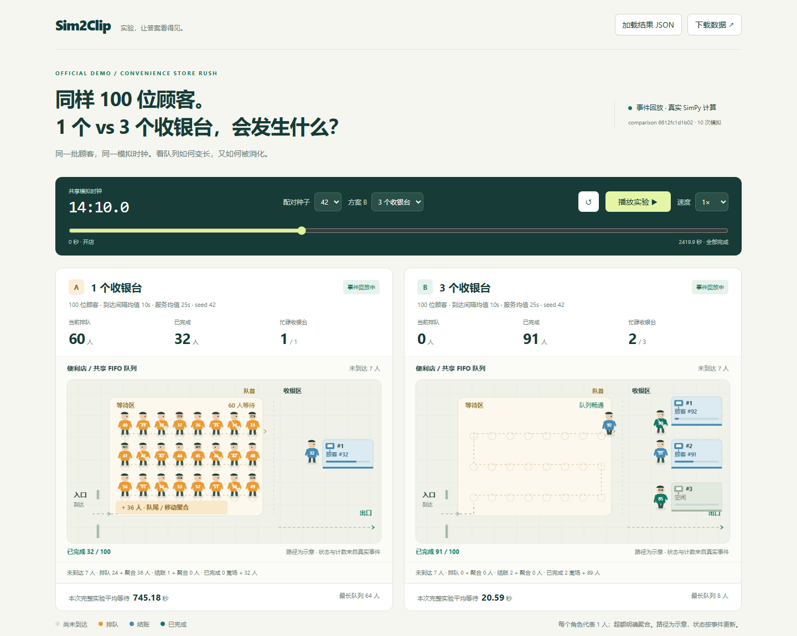

# Queue：事件驱动的 2D 场景

Queue 场景由真实事件状态驱动，通过确定性位置层呈现顾客移动和共享 FIFO 队列。
本文记录桌面场景的实现及验收。
竖屏布局见 [9:16 舞台](visualization-vertical-7.3.md)，叙事播放见 [Presentation Mode](presentation-mode-7.4.md)。

## 打开与检查

截图使用已保存的 Queue 比较结果，默认 Seed 42。无需安装的观看方式见 [Demo 与离线包](release-demo.md)。

共享时钟下，850 秒时 A 排队 60 人、完成 32 人，B 排队 0 人、完成 91 人。A 显示 24 个排队角色加 36 人聚合；B 的服务和离场角色均是该时刻真实的顾客 ID。



现有播放、暂停、拖动、倍速、重播、种子/方案切换、加载结果、原始数据下载、参数、指标、报告和真实 Agent 时间线继续保留。Analysis 的 1× 完整回放约 36 秒，便于看清移动；2× 和 0.5× 分别约 18 秒和 72 秒。这只是模拟时钟推进速度，不改变事件、参数、结果或统计单位。

## 模块与职责

所有实现文件位于 `src/sim2clip/visualization/`，测试位于 `tests/visualization/`。

| 文件 | 职责 |
| --- | --- |
| `assets/design.json` | 720×440 单店逻辑画布、蛇形槽位、聚合阈值、24 模拟秒运动窗口、36 秒播放基准与颜色 |
| `scene.py` | Python SceneTimeline / ScenePose；确定性轨迹、收银台位置、精确聚合与浏览器对照基准 |
| `assets/replay-core.js` | 既有契约校验与精确事件回放，从 replay.js 提取并保留原语义 |
| `assets/scene.js` | 浏览器确定性位置索引与 Canvas 2D 场景绘制 |
| `assets/replay.js` | 播放器调度、场景重建、精确状态与位置衔接、可见和聚合人数说明 |
| `html.py` | 内嵌共享设计及场景对应的样式、回放与展示脚本，支持离线页面 |
| `assets/page.html` | 真实人物与视觉聚合的图例说明 |
| `assets/style.css` | 场景画布比例和人数核对行，支持桌面/手机布局 |
| `test_scene.py` | 15 项位置层与人数守恒测试 |
| `test_scene_browser.py` | 9 项真实 Chromium 位置比对及交互测试 |
| `capture_scene.py` | 仅消费保存结果的截图与浏览器验收脚本 |
| `docs/assets/phase7-2/*` | 四张已保存的关键场景截图 |

展示路径和人物移动属于位置层，不改变事件时刻、模拟指标或实验参数。

## 确定性位置如何实现

数据流为：SimulationEvent → 精确 ReplaySnapshot → ScenePose → Canvas 2D。

SceneTimeline 加载时先用现有 EventReplay 验证证据，再按 timestamp 分组、sequence 顺序结算所有同刻事件，给可见顾客建立轨迹关键帧。FIFO 槽位从队首向蛇形队尾排列；每个 cashier_id 有独立逻辑坐标，顾客的服务目标来自真实 CustomerRecord。

每条轨迹包含真实事件时刻、固定路径、显示持续时间和队列位置。通过二分查找当前模拟时间所属轨迹，再按路径长度与 smoothstep 计算坐标；不会读取上一渲染帧的位置。新轨迹起点来自已经建立的事件轨迹在该时刻的解析位置，不依赖浏览器播放历史。

waiting 的移动窗口不超过真实服务开始时刻；serving 的移动窗口不超过真实服务时长的 45%；completed 离场窗口不超过共享回放终点。状态、排队人数、完成数和收银台占用直接读取当前 ReplaySnapshot，在事件时刻立即变化。柜台进度只表示该真实服务窗口内的进度，不产生完成事件。

零等待顾客不会生成虚假的 waiting 轨迹。t=0 时首位顾客已经处于 serving，即使身体正在从入口沿示意路径移动。收银台会立即显示真实顾客编号；页面明确说明路径是视觉示意。

pause 冻结模拟时钟，因此坐标、朝向与离场透明度也冻结；反向 seek 不存在旧动画定时器。种子、方案和结果切换创建新的 SceneTimeline 并丢弃旧场景。customer_id 始终为实体主键，其造型小变化由 ID % 4 确定，A/B 共用相同身份映射。

Python 与 JavaScript 在终点和路径转角使用明确的边界规则与浮点容差，避免几何终点的朝向因累计长度误差而不同。

## 聚合与可读性

等待区最多有 24 个可见人物，收银区显示前 6 个独立柜台，离场窗口最多显示 3 个实际完成顾客。其他人仍包含在真实状态与计数中；隐藏柜台有独立逻辑位置，并显示隐藏柜台总数与忙碌数。

同时到达或移动会让多个角色处于相近坐标。ScenePose 根据固定规则聚合在 28×48 逻辑像素身体占位范围内重叠的角色，优先保留 serving，其次 FIFO 顺序的 waiting，再保留 completed。聚合只决定是否绘制身体，不改变轨迹、身份或状态。队列标注“队尾 / 移动聚合”，下方人数行明确列出各状态的可见和聚合数量，避免将暂时遮挡误认为顾客消失。

每个时间点满足：

```text
未到达 + 排队 + 正在服务 + 已完成 = config.customers
可见排队 + 聚合排队 = 精确队列长度
可见服务 + 聚合服务 = 忙碌收银台数
可见离场 + 完成聚合 = 已完成数
```

场景保留深绿、米白、橙、蓝、绿配色。人物有头部、衣服、手脚、稳定身份标记与运动步态；收银台显示编号、真实顾客和服务进度。场景在高像素比设备上按设备像素比绘制，最高 2×，没有引入第三方前端依赖。

## 实际测试与 Chromium 验收

全量测试命令：

```powershell
uv run pytest tests/visualization/test_scene.py tests/visualization/test_scene_browser.py -q
.\.venv\Scripts\python.exe -m ruff check .
.\.venv\Scripts\python.exe -m ruff format --check .
.\.venv\Scripts\python.exe -m mypy
```

已保存的桌面场景验收为 **216 passed，无跳过**，包含 9 项 Chromium 场景测试。Ruff、格式检查及 strict mypy 通过。

测试覆盖每个事件时刻与事件间隔、非单调 seek、事件前/等于/后、FIFO 目标位置、cashier_id 映射、身份唯一、四态人数守恒、即时完成和占用、同刻多事件、聚合、非连续顾客 ID、1/3/8/100 收银台、2× 播放以及切换种子/结果后的重建。

真实 Chromium 155.0.8059.39 检查了播放中的像素变化、暂停后位置冻结、实际播放到中段、反向 seek 恢复同一位置、A/B 共享时钟和离线加载。Python/JS 比对涵盖两组全部事件时刻、事件后 0.001 秒及相邻事件中点。页面错误和外部网络请求均为 0。

先按 README 运行 Queue Demo，再对生成结果截图；输出目录必须未被占用：

```powershell
uv run python tests/visualization/capture_scene.py --result outputs/queue-demo/result.json --timeline outputs/queue-demo/agent-timeline.json --report outputs/queue-demo/report.md --output outputs/my-queue-scene
```

该脚本必须启动真实浏览器，失败会报错，不会以 skip 代替验收。

| 截图 | 真实时刻与场景 |
| --- | --- |
| [初始场景](assets/phase7-2/initial.png) | 0 秒；两组均已开始服务首位顾客，另外 99 人未到达 |
| [排队高峰](assets/phase7-2/queue-peak.png) | 922.169929 秒；A 排队 64、完成 35；B 排队 1、完成 96 |
| [A/B 明显差异](assets/phase7-2/ab-difference.png) | 850 秒；A 排队 60、完成 32；B 排队 0、完成 91 |
| [实际播放中段](assets/phase7-2/playback-middle.png) | 本次捕获约 1211.351384 秒；A 排队 53、完成 46；B 全部完成 100 |

上述 4 张为 1440×1150 桌面截图，人工检查了人物密度、队列标签、柜台标签、入口/出口和聚合说明。队列标题位置已调整，人物中心重叠被聚合处理，未发现横向溢出或关键文字遮挡。

竖屏观看方式见 [9:16 舞台](visualization-vertical-7.3.md)。

10000 顾客固定测试样本的本机测量：Python 建立轨迹约 1.40 秒、8 次非单调 seek 约 42ms；Chromium 建立轨迹约 130ms、8 次 seek 约 10ms。这是测试夹具，不用于展示，也不替换官方实验数据；耗时依设备而变，不是性能保证。

## 已知限制

- 位置是固定店面中的示意路径，不能解释为真实步行速度或新增的服务延迟。
- 高速回放和极短服务可能跨过整段移动，状态与统计仍准确。聚合角色可能在移动中暂时切入/切出显示，这是确定性的视觉简化。
- 共享终点不添加离场尾帧；恰好在终点完成的最后顾客直接计入完成聚合，不延长实验时间。
- 只显示前 6 个柜台的身体与柜台图形，更多柜台通过准确占用计数表示，没有新增分页控件。
- Analysis 直接显示最终指标；Presentation 按阶段揭晓结果。发布 GIF 与普通 CLI GIF 使用不同录制/导出路径，见 [Demo 素材](release-demo.md)。
- 该场景不提供人物选择/悬停详情；二维展示不增加模拟类型。
