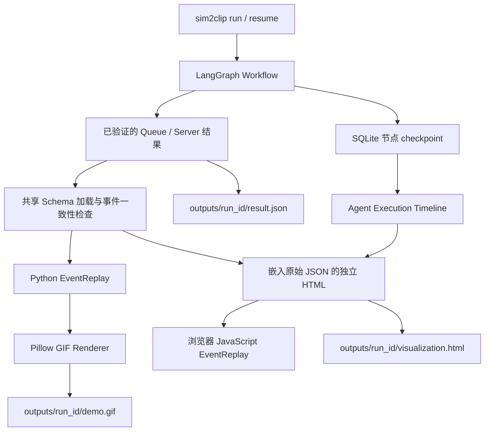

# Visualization：事件回放与离线展示

展示层从已验证的 Queue / Server 结果导出自包含 HTML，不调用模型、MCP 或模拟函数。
CLI 在工作流完成后读取保存结果及 checkpoint，生成公开展示资料。

- [Queue 2D 场景](visualization-2d.md)：确定性轨迹、共享 FIFO 和人数聚合。
- [Server 回放](server-visualization-m4.md)：请求分流、独立队列及服务器状态。
- [9:16 舞台](visualization-vertical-7.3.md)：双场景竖屏构图。
- [Presentation Mode](presentation-mode-7.4.md)：六阶段叙事、双时钟及结果揭晓。
- [发布 Demo](release-demo.md)：README GIF、竖屏 MP4 和离线 ZIP。

下文说明 Queue 回放及普通 GIF 导出；Server 的独立事件语义见对应文档。
普通 CLI GIF 与发布录制 GIF 使用不同路径，不能混用规格或验收记录。

## 架构与文件职责



```text
src/sim2clip/visualization/
  __init__.py       公共加载、回放、导出入口
  data.py           复用共享 Pydantic 结果契约；选择真实 seed / A、B 组
  replay.py         事件状态机、FIFO / 生命周期检查、前进与反向 seek
  timeline.py       从 checkpoint 状态增量提取节点和工具记录
  html.py           嵌入原始结果、共享 JSON Schema、报告与时间线
  gif.py            Pillow 绘图、统一模拟时钟、固定调色板、逐帧清单
  pipeline.py       校验、渲染、原子写入可分享的展示产物
  assets/
    page.html       无外部依赖的单页模板
    style.css       桌面与移动布局
    replay.js       浏览器回放、控制、结果文件加载和下载
tests/visualization/
  conftest.py
  test_replay.py
  test_exports.py
  test_browser.py
  test_pipeline.py
docs/assets/
  demo-result.json  已保存的 Queue 结果，用于兼容性复核
```

展示状态模型包含 `ReplaySnapshot`（顾客状态、队列、收银台、完成数与已应用事件数），
业务参数、事件及结果沿用共享 Schema。浏览器使用 Python 共享模型生成的
JSON Schema 检查输入，再检查生命周期与事件/记录/指标一致性。

## 回放语义

按原始 sequence 消费所有 `timestamp <= clock` 的事件，保留同刻事件的原始顺序。
同一时间戳全部事件完成后绘制。到达进入 FIFO 队列；开始服务移出队列并占用收银台；
完成服务释放收银台。顾客状态只由事件改变，动画不生成到达、服务时长或实验结果。

两组使用相同模拟秒数，回放总长为两组完成时间的最大值。先完成的一组保持完成状态，
不会通过分别归一化进度制造假同步。向后拖动会重置状态并重放；所有快照独立复制。

官方案例默认回放 seed 42：100 位顾客、1 vs 3 收银台，到达均值 10 秒、服务均值 25 秒。
seed 42 单次平均等待 745.18 / 20.59 秒，最长队列 64 / 8 人；
5 个配对种子 42–46 的平均等待为 789.52 / 33.27 秒。
每个动画面板显示当前选中种子的完整实验指标，汇总表单独标注多种子均值。

结果包含多个方案时，A 使用请求中的基准方案，B 可切换为其他方案；种子可切换。
GIF 默认展示请求中的前两个方案，优先选已有 seed 42。
其他输入没有 seed 42 时回放实际存在的第一个种子，注明真实种子，不额外运行实验。
单 SimulationResult 显示单个面板，提示 A/B 需要 ComparisonResult。

HTML 的 Queue 场景显示最多 24 个排队角色和前 6 个柜台，其余人员与柜台精确聚合。
普通 Queue GIF 队列显示前 36 人、状态图显示前 100 人。
所有计数包含完整实验人群，超出可见部分有明确说明。

缺失事件、乱序、重复生命周期、FIFO 错误、收银台占用冲突或事件指标不一致会明确拒绝。
加载错误的 JSON 时，浏览器保留上一份有效结果并显示错误；不会补造轨迹。
新加载结果不继承旧任务的 Agent 时间线或报告。

## Agent 时间线

从原 Graph 的 checkpoint 历史（或 SQLite 记录）按节点完成顺序提取 State 增量：
Planner、Parameter Validator、MCP Tool Call、Result Validator、Report。
展示原节点名、轮次、动作、状态、checkpoint 时间，以及工具名称、attempt 和参数。
重规划与工具重试在时间线中保留，体现 Agent 的条件决策过程。

时间表示节点完成时的 checkpoint 保存时间，不是节点开始时间或精确耗时。
普通 CLI 导出保留运行时间，浏览器按本地时区显示。
公开离线包省略可选的运行时间字段，保留节点顺序、工具参数和验证结论。
只有 state.json 时按原决策顺序展示，时间标为“未记录”；只有结果 JSON 时提示没有 Agent 记录。
提供不属于该结果的 state.json 会被拒绝。

## 使用流程

```powershell
uv sync --locked
uv run sim2clip run "100个顾客，比较1个收银台和3个收银台" --planner demo --thread-id lunch-demo
```

直接双击 `outputs/lunch-demo/visualization.html`。页面自带 CSS、JS 和数据，无 CDN、服务端
或网络请求。原始 `result.json` 仍是完整共享结果契约，HTML 内嵌的数据与它逐字段一致。
GIF 使用 Pillow 在 Python 内生成，生产环境不需要 Playwright、Node 或浏览器。
GIF 使用英文标签以避免依赖额外的中文字库；HTML 保留中文产品界面。

普通 Queue 导出包含以下文件；Server 不生成 demo.gif / demo.frames.json，另有 Presentation Manifest。

| 文件 | 内容 |
| --- | --- |
| report.md | 从已验证结果生成的公开报告 |
| result.json | 最终完整 ComparisonResult 或 SimulationResult |
| visualization.html | A/B 同步回放、参数、汇总、时间线和报告 |
| demo.gif | 1200×720、121 帧、约 16.1 秒的循环回放 |
| demo.frames.json | 每帧模拟时刻、时长、队列/完成/收银台计数、事件游标、JSON/GIF SHA-256 |
| agent-timeline.json | 可审计的节点完成与工具记录 |
| state.json / decisions.json / graph.mmd | 检查快照与 Graph |

恢复资料和原始证据保存在本地输出目录，公开 HTML 只读取已验证的展示数据。
展示目录包含公开投影；恢复仍需原始 SQLite 和工具收据，公开 State 不能替代恢复资料。
暂停或失败不会生成成功动画；完成任务 resume 可重新导出，不重跑已完成工具。
`--skip-visualization` 用于只运行实验的批处理。默认输出根目录为 `outputs`；
恢复旧任务时传入原来的 `--output`。

如果 Agent 规划多个独立 `run_simulation` 调用，默认回放最后一个结果，并在页面说明。
全部独立结果另存于 `results/<result_id>.json`，可逐一加载；不会伪造共享样本的 A/B 对比。
标准 A/B 实验使用现有 `compare_simulations` 工具，其完整结果包含全部方案与种子。

重新渲染既有文件：

```powershell
uv run sim2clip visualize outputs/lunch-demo/result.json --output outputs/replay
uv run sim2clip visualize outputs/lunch-demo/result.json --state outputs/lunch-demo/state.json --checkpoint "path/to/checkpoint.sqlite" --output outputs/replay-with-agent
```

也可独立使用 Python 公共 API：

```python
from pathlib import Path
from sim2clip.visualization import load_result, export_demo

result = load_result(Path("outputs/lunch-demo/result.json"))
export_demo(result, Path("outputs/replay"))
```

GIF 的帧清单和内嵌 comment 都记录原始 JSON 哈希；帧清单另记录 GIF 哈希。
相同数据、渲染版本、Pillow 版本与字体环境产生相同 GIF；跨字体环境不承诺文件字节相同。
GIF 使用固定调色板避免闪烁，开始与结尾停留便于读标题和结果。

## 测试与实现依据

```powershell
uv run pytest tests/visualization -q
uv run pytest -q
uv run ruff check .
uv run ruff format --check .
uv run mypy
```

导出测试包含手算、同刻事件结算、共享时钟、反向 seek、事件损坏、原始数据往返、
GIF 完整逐帧核对、哈希与时长、JSON 注入防护、真实浏览器回放与 Python 全事件时间点一致、
播放/暂停/拖动、不同实验加载、种子/方案切换、无外部网络资产、桌面和移动布局，
以及 CLI 完成/暂停/恢复/已有数据重新导出。
已保存的初始导出验收为 **192 项测试通过，无跳过项**；
Ruff、格式检查、strict mypy、锁文件检查及 wheel / sdist 构建通过，安装包包含展示静态资源。

浏览器测试会优先使用已安装 Chrome / Edge，也可通过 `SIM2CLIP_BROWSER_EXECUTABLE`
指定浏览器，或运行 `uv run playwright install chromium`；未安装浏览器时明确 skip。

渲染与测试采用官方 [Pillow GIF 格式文档](https://pillow.readthedocs.io/en/stable/handbook/image-file-formats.html#gif)
和 [Playwright Python 截图文档](https://playwright.dev/python/docs/screenshots)。
